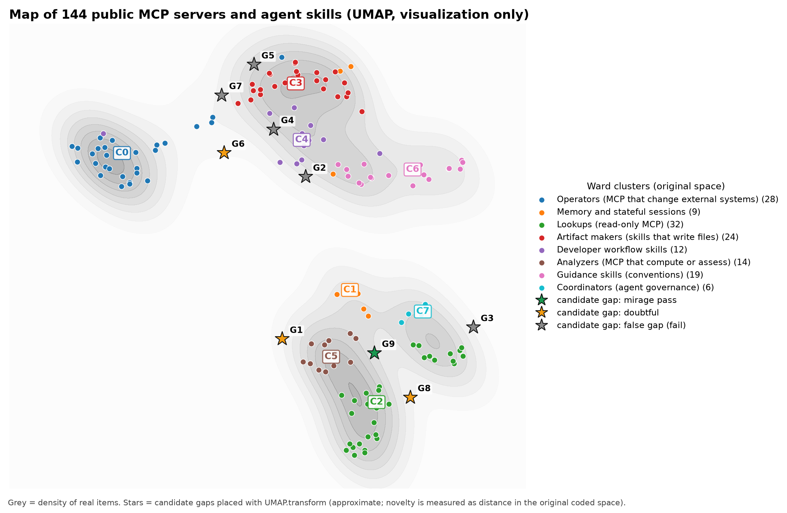

# Example: MCP servers & agent skills

A real, public case for niche-map: 144 MCP servers and agent skills coded on 10 dimensions. Start with [WALKTHROUGH.md](WALKTHROUGH.md); the coding rules are in [RUBRIC.md](RUBRIC.md).

© 2026 Juan Manuel de Villeros. Data and docs CC BY 4.0, code MIT.
